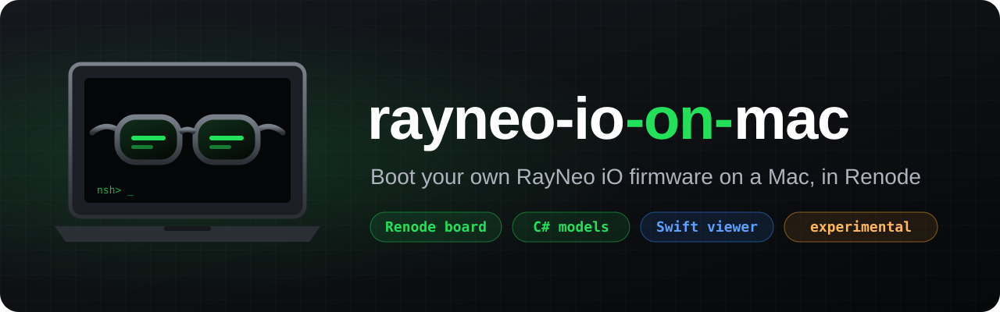
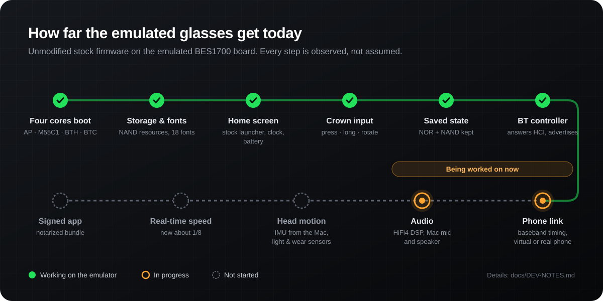
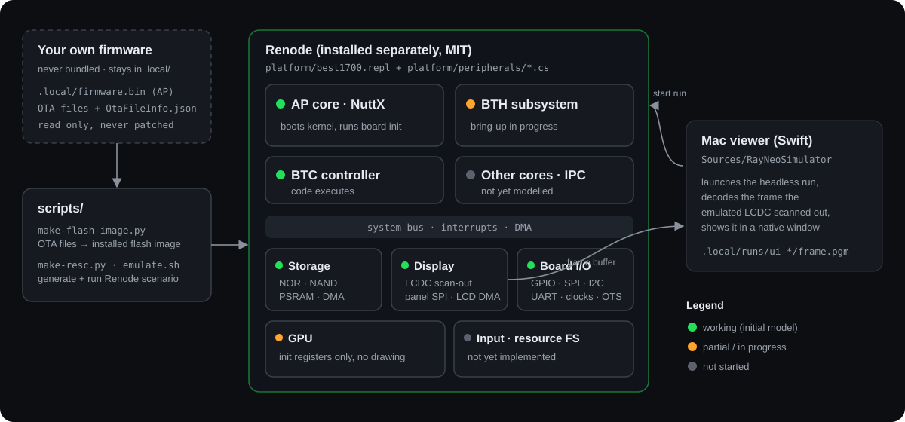

<p align="center">
  
</p>

<p align="center">
  <b>A full-system emulator experiment for RayNeo iO smart glasses, running on your Mac.</b><br>
  A Renode board model plus a native Swift viewer, aimed at booting the <i>unmodified</i> stock firmware and showing its real display output.
</p>

<p align="center">
  <a href="LICENSE"></a>
  
  
  
  
</p>

<p align="center">
  <a href="#status">Status</a> ·
  <a href="#quick-start">Quick start</a> ·
  <a href="#architecture">Architecture</a> ·
  <a href="#roadmap">Roadmap</a> ·
  <a href="#how-to-help">How to help</a> ·
  <a href="#中文">中文</a>
</p>

> [!IMPORTANT]
> **No firmware is distributed here.** You must bring your own. This is an unofficial project and is not affiliated with or endorsed by RayNeo, Bestechnic or any other vendor. It only emulates on a computer and never flashes hardware.

## Why

Developing for smart glasses usually means flashing a real device for every change, with a real chance of bricking it. A faithful emulator changes that:

- **Iterate safely.** Boot the firmware you already own on your laptop, as many times as you like.
- **Learn the hardware honestly.** Every peripheral model is written from what the firmware actually does on the emulated bus, not from guesses dressed up as results.
- **No patched instructions.** The goal is to run the stock image as-is. When something fails, we fix the model, not the firmware.

## Status

The unmodified stock firmware **boots to its real home screen, responds to the crown, plays and records audio, and links to a virtual BLE phone**. It is still not a complete device: phone-app features, classic Bluetooth and head gestures are not done yet.

<p align="center">
  
</p>

| Area | State | Notes |
|---|---|---|
| Four cores (AP, M55C1, BTH, BTC) | Working | All start from installed-format flash images built from your OTA set; inter-core mailboxes and rpmsg run |
| Home screen | Working | The stock launcher reaches its home page about 12 s into emulated time; a paired-phone record is seeded in NOR user data (`BOND=0` keeps the factory pairing guide) |
| Fonts | Working | All 18 `nand_font` files load: four come from your own RayNeo AI app, the rest are the same open-source families fetched upstream (`scripts/prepare-fonts.sh`) |
| Clock, batteries | Working | PMU RTC follows the Mac clock; two MAX17335 gauges report charge; USB detect idles unplugged |
| Crown | Working | Press, double press, long press and rotation are handled by the firmware itself (`Tests/scenarios/`) |
| Timers, I2C, GPU, display | Working | SP804 hwtimers, a DesignWare I2C model, VGLite command execution, two-eye scan-out |
| Persistence | Working | The app saves NOR and NAND on quit and restores them, so settings and pairing survive; "Factory reset" clears them |
| Bluetooth (BLE) | Partial | Baseband timing model: advertising, page timeouts and reconnect retries run like hardware. A virtual phone (`scripts/ble-peer.py`) connects over the link layer, discovers GATT and receives rnlink frames; the phone side of rnlink is not implemented yet, so phone features still wait for the app |
| Bluetooth classic (SPP, iAP2, A2DP, HFP) | Not started | iAP2 on a real iPhone also needs the MFi authentication chip, which an emulator cannot sign |
| Audio | Partial | The HiFi4 DSP is not executed; its AP-facing contract (mailbox, rpmsg, smf streams) is implemented. Recording delivers Mac or file audio to the firmware as Opus; playback is decoded to the Mac speaker. Wake word and noise suppression are not reproduced |
| Sensors | Partial | Ambient light (W1160) and magnetometer (MMC5603NJ) are detected. The IMU (own LSM6DSO32 model) delivers FIFO data to the BTH head-posture monitor through the BTH GPIO interrupt path and can be driven from the host (`headMotion`). Head-up wake (an app setting, off by default) and nod/shake (enabled by the firmware only in contexts such as calls) still need the phone side to verify. The iO has no wear sensor. Wi-Fi is not modelled |
| Speed | Slow | About 1/8 of real time; boot to home takes about 2 minutes. Cores run serially in one emulation thread (needs Renode 1.17.0+20261016, `scripts/get-renode.sh`) |
| Calibration | Unverified | Several register, ID and clock values are inferred from firmware, not measured on hardware |

The detailed engineering log lives in [`docs/DEV-NOTES.md`](docs/DEV-NOTES.md).

## Quick start

Requirements: macOS 14 or later, Xcode command line tools, Python 3, and [Renode](https://renode.io) (MIT licensed, installed separately, **not bundled**).

```sh
git clone https://github.com/owenc1122/rayneo-io-on-mac.git && cd rayneo-io-on-mac

sh scripts/setup-tools.sh                    # one-time: Python venv with littlefs-python and fonttools
sh scripts/prepare-fonts.sh /path/to/RayNeo\ AI.app   # glasses fonts from your own RayNeo AI app
sh scripts/get-renode.sh                     # Renode 1.17.0+20261016 into .local/renode (or export RENODE=...)

FONTS=.local/fonts-factory sh scripts/emulate.sh <ota-files-dir> 30 .local/runs/demo   # headless run
SCENARIO=Tests/scenarios/crown.txt FONTS=.local/fonts-factory sh scripts/emulate.sh <ota-files-dir> 20 .local/runs/crown

BUNDLE_RENODE=1 sh scripts/build-app.sh      # builds "build/RayNeo io on Mac.app"
sh scripts/run-app.sh
```

In the app: hold Space to press the crown (hold longer for a long press), D for a double press, arrow keys or the scroll wheel to rotate. The app asks for your firmware folder once and keeps a private copy; run data lives in `~/Library/Application Support/RayNeo io on Mac/`.

### Bring your own firmware

No vendor firmware, OTA package, fonts, or images and assets extracted from them are included. Get the Strix OS files from your own device or another lawful source and keep them under `.local/` (git-ignored), or choose them in the app. The scripts only read these files and never modify them.

## Architecture

<p align="center">
  
</p>

| Path | What lives there |
|---|---|
| [`platform/`](platform/) | Renode board description (`best1700.repl`) and C# peripheral models (`peripherals/*.cs`) |
| [`scripts/`](scripts/) | App build and launch, headless emulation, installed flash image builder, peripheral checks |
| [`Sources/RayNeoSimulator/`](Sources/RayNeoSimulator/) | Swift macOS app: starts the Renode run and displays completed scan-outs |
| [`Tests/`](Tests/) | Swift unit tests and Renode storage test scripts |

## Roadmap

- [x] All four cores boot the unmodified firmware
- [x] Display scan-out, GPU draw commands, two-eye layout
- [x] Resource filesystem and fonts; stock home screen
- [x] Crown press and rotation from the Mac keyboard and trackpad
- [x] Clock, battery gauges, hardware timers, I2C
- [x] Glasses state saved between app sessions
- [x] Bluetooth baseband timing; virtual BLE phone connects
- [ ] Phone side of rnlink: notifications, navigation, captions, AI and the other phone features
- [ ] Classic Bluetooth: SPP, A2DP, HFP
- [x] Audio in and out through the DSP contract
- [ ] Wake word and noise suppression
- [ ] Head motion from the Mac, light and wear sensors
- [ ] Real-time speed
- [ ] Signed, notarized app bundle

## How to help

This project moves fastest with people who know embedded hardware, Renode or NuttX.

- **Peripheral models.** Pick an unimplemented block, read what the firmware does with it in a trace, and model that behaviour in `platform/peripherals/`.
- **Hardware measurements.** If you own the glasses and can read real register, ID or clock values without modifying the device, they can replace our inferred assumptions.
- **Tests.** Every model should come with a check script that fails loudly when behaviour regresses.
- **Reports.** Open an issue with your macOS version, Renode version and the tail of `boot.log`. Do **not** attach firmware, extracted images or screenshots of the firmware's own output.

Keep contributions original: no vendor code, binaries or assets, and no code ported from other projects whose license or origin is unclear.

## License

Original code is released under the [MIT License](LICENSE). Renode is MIT licensed and installed separately by the user; it is not bundled. Firmware and its contents belong to their respective rights holders and are not covered by this license.

> **Disclaimer.** Unofficial and not affiliated with or endorsed by RayNeo, Bestechnic or any vendor; names are used only to describe what this interoperates with. This project only emulates on a computer and never flashes hardware. Applying anything learned here to a real device can brick it, void the warranty or breach vendor terms, at your own risk. Provided "as is", without warranty of any kind.

---

## 中文

**雷鸟 iO（RayNeo iO）眼镜的整机模拟器实验，跑在你的 Mac 上。** 基于 [Renode](https://renode.io) 的 BES1700 板级模型 + Swift 原生窗口，目标是运行**原版、未修改指令的**固件，并显示它真实的画面输出。

> **本仓库不分发任何固件，需自备。** 本项目为非官方项目，与雷鸟创新（RayNeo）、Bestechnic 或任何厂商无关联、未获认可；只在电脑上模拟，从不刷写设备。

### 当前进度（如实说明）

**原版固件已能进入真实桌面、响应表冠、录音和放音，并能和虚拟 BLE 手机建立连接；但还不是完整的眼镜：依赖手机 App 的功能、经典蓝牙和头部手势还没做好。**

| 部分 | 状态 | 说明 |
|---|---|---|
| 四个核（AP、M55C1、BTH、BTC） | 可用 | 由你的 OTA 文件生成已安装格式镜像后全部启动，核间邮箱和 rpmsg 正常 |
| 桌面 | 可用 | 原厂 Launcher 约在模拟时间 12 秒进入主页；NOR 用户数据区预置已配对手机记录（`BOND=0` 保留出厂配对引导） |
| 字体 | 可用 | 18 个字体全部加载：4 个来自你自己的雷鸟 AI App，其余为同一开源字族（`scripts/prepare-fonts.sh`） |
| 时间、电池 | 可用 | PMU 时钟跟随 Mac；两颗 MAX17335 电量计；USB 检测默认未插线 |
| 表冠 | 可用 | 单击、双击、长按、旋转都由固件自己处理（`Tests/scenarios/`） |
| 定时器、I2C、GPU、显示 | 可用 | SP804 硬件定时器、DesignWare I2C、VGLite 绘制、双眼扫描输出 |
| 状态保存 | 可用 | 应用退出时保存 NOR 和 NAND，下次恢复；「恢复出厂设置」清除 |
| 蓝牙（BLE） | 部分 | 基带时序模型：广播、寻呼超时、回连重试按硬件节奏运行。虚拟手机（`scripts/ble-peer.py`）能在链路层连上、发现 GATT 并收到 rnlink 帧；手机端 rnlink 协议还没实现，依赖手机的功能仍在等待 App |
| 经典蓝牙（SPP、iAP2、A2DP、HFP） | 未开始 | 真 iPhone 的 iAP2 还需要 MFi 认证芯片签名，模拟器无法产生 |
| 音频 | 部分 | 不执行 HiFi4 DSP，而是实现它对 AP 的接口（邮箱、rpmsg、smf 流）。录音把 Mac 或文件的声音以 Opus 送入固件，播放解码到 Mac 扬声器；唤醒词与降噪未复现 |
| 传感器 | 部分 | 光感（W1160）、磁力计（MMC5603NJ）已被识别。IMU（自建 LSM6DSO32 模型）经 BTH 的 GPIO 中断把 FIFO 数据送进颈部姿态监测，可由主机驱动（`headMotion`）。抬头亮屏（App 开关，默认关）和点头/摇头（固件只在来电等场景开启）要等手机端才能验证。iO 没有佩戴传感器。Wi‑Fi 未建模 |
| 速度 | 慢 | 约为实时的 1/8，开机到桌面约 2 分钟；四个核串行执行（需 Renode 1.17.0+20261016，`scripts/get-renode.sh`） |
| 校准 | 未验证 | 多处寄存器、ID、时钟值从固件推断，未经实机测量 |

详细开发记录见 [`docs/DEV-NOTES.md`](docs/DEV-NOTES.md)。

### 快速开始

需要 macOS 14+、Xcode 命令行工具、Python 3，以及另行安装的 Renode（MIT，**不随仓库分发**）。

```sh
sh scripts/setup-tools.sh
sh scripts/prepare-fonts.sh /path/to/RayNeo\ AI.app     # 从你自己的雷鸟 AI App 生成眼镜字体
FONTS=.local/fonts-factory sh scripts/emulate.sh <OTA 文件目录> 30 .local/runs/demo
BUNDLE_RENODE=1 sh scripts/build-app.sh && sh scripts/run-app.sh
```

应用里：按住空格=按表冠（按久就是长按），D=双击，方向键或滚轮=旋转。

### 自备固件

本仓库**不包含**任何厂商固件、OTA 包或从中提取的镜像与图片。请从你自己的设备或其他合法渠道取得 Strix OS 固件，放在 `.local/`（已 gitignore）。脚本只读取这些文件，不做任何修改。

### 架构与路线图

启动进度见上方 [Status](#status) 图，架构图见 [Architecture](#architecture)。下一步：蓝牙基带时序与手机连接（虚拟手机，或经 Mac 桥接真手机）、音频（HiFi4 DSP、Mac 麦克风/扬声器）、用 Mac 模拟头部动作及光感/佩戴传感器、提速到实时、签名公证的应用。

### 如何参与

欢迎熟悉嵌入式、Renode 或 NuttX 的朋友：补外设模型、提供（不改设备即可读取的）实机寄存器测量值、为模型写检查脚本、报告运行结果。提 issue 时请附 macOS / Renode 版本和 `boot.log` 末尾，**不要**附固件、提取的镜像或固件画面截图。贡献须为原创。

### 许可与免责

原创代码采用 [MIT](LICENSE)。Renode 采用 MIT 许可，由使用者自行安装。固件及其内容归各自权利人所有，不在本许可范围内。

> **免责声明。** 本项目为非官方项目，名称仅用于说明互操作对象。本项目只在电脑上模拟，不刷写设备；若你把从中获得的知识用于修改或刷写实体设备，可能导致变砖、失去保修或违反厂商条款，风险自负。软件按“原样”提供，不附带任何担保。
